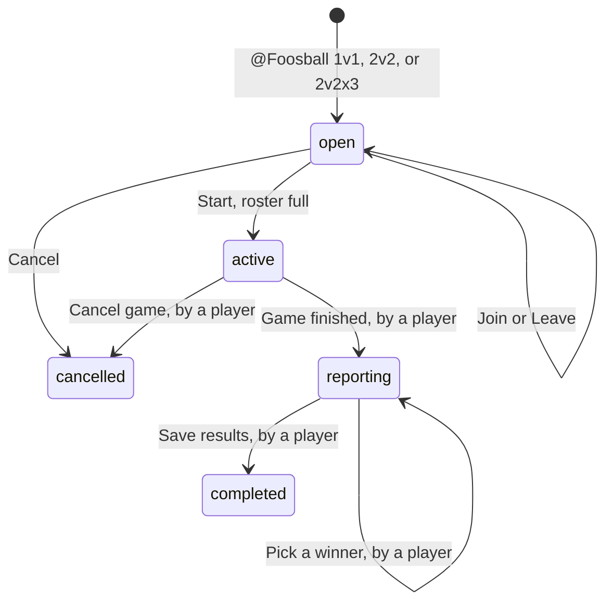

# Foosball

A Slack app for in-office foosball. Someone opens a 1v1, a 2v2, or a 2v2 long game in a channel, players join, and the matching ladder updates from the results. 1v1 and 2v2 have separate ladders. A 2v2 long game uses the 2v2 ladder.

The app is one AWS Lambda behind a Function URL, with DynamoDB for games and ratings. AWS CDK deploys it. Install the Slack app from the manifest, deploy, then paste `SlackRequestUrl` into Slack. The API key is already on that URL as `?key=`.

## Commands

Mention **@Foosball** in a channel the app has been invited to. Slack only delivers that mention there, so the app stays out of every other channel. Invite it to each channel that should play. The same app can be in several channels, and each channel gets its own games. The ladders stay per workspace.

| Command | Effect |
| --- | --- |
| `@Foosball 1v1` | Posts a new 1v1 in that channel. The caller is not added until they press Join. |
| `@Foosball 2v2` | Posts a new 2v2. Players join Team A or Team B. One game when both teams have two players. |
| `@Foosball 2v2x3` | Posts a 2v2 long game. Four players, three games, and each person partners with each of the others once. |
| `@Foosball top` | Posts both workspace ladders in that channel. |
| `@Foosball info` | Posts what the app is, how a game works, and the commands. |
| `@Foosball ping` | Checks whether the app is up. The reply is `pong!`. |

`@Foosball` on its own, and any other word, replies “Unknown command, use `info` for available commands” and does not open a game. Commands are case-insensitive. Everyone in the channel sees these messages.

Several games may be open in the same channel at once.

## Game flow

A game is one message. Slack shows that message to everyone, and a button cannot be disabled, so the buttons on the message change with the phase. Join and Leave are both shown while the game is open. A click that does not apply (already joined, not in the game, game full) gets an ephemeral note and leaves the message as it is.



Roster order is join order. Leaving removes that person and keeps the remaining order. A 2v2 long game uses that order as A, B, C, D. A 2v2 is Team A against Team B. A 1v1 uses join order as A vs B.

**Open.** A 1v1 starts at 0/2. A 2v2 starts with Team A 0/2 and Team B 0/2. A 2v2 long game starts at 0/4.

```
New 2v2 long game
Join the game (0/4)

1. _waiting_
2. _waiting_
3. _waiting_
4. _waiting_

[Join] [Leave] [Cancel]
```

Start is added only when the roster is full. Anyone may cancel an open game. Only a joined player may start it.

**Active, 2v2.** One game, Team A vs Team B. Both teammates receive the same rating change.

**Active, 2v2 long game.** The roster is locked. Pairings, in order:

1. A+B vs C+D
2. A+C vs B+D
3. A+D vs B+C

Each person partners with each of the other three once.

```
2v2 long game in progress
@a, @b, @c, @d

1. @a + @b  vs  @c + @d
2. @a + @c  vs  @b + @d
3. @a + @d  vs  @b + @c

[Game finished] [Cancel game]
```

**Active, 1v1.** One game, A vs B.

```
1v1 in progress
@a, @b

@a vs @b

[Game finished] [Cancel game]
```

Only the players in the game can finish or cancel. Cancel posts `Cancelled by @name` and removes the buttons.

**Reporting.** The message lists each game. Each game has two buttons, one per side. A chosen side stays marked, and another player may change it until save. Save appears once every game has a winner. There is no draw.

**Completed.** The message lists who won each game and each player's rating change on that ladder (`1000 → 1016 (+16)`) plus that ladder's wins and losses. No buttons. Saving again does not apply ratings twice; the handler shows the completed message.

## Ratings

Each format has its own rating, per Slack workspace. A person starts at **1000**, with 0 wins and 0 losses, the first time a completed game of that format includes them. They stay off a ladder until that happens. A 2v2 does not move the 1v1 rating, and a 1v1 does not move the 2v2 rating. Cancelled games do not create players.

A 2v2 and a 1v1 each rate their one game. A 2v2 long game rates its three games in order. Game 2 uses the ratings produced by game 1.

Team rating is the average of the players on that side. In a 1v1 that average is the player's own rating. Both teammates in a 2v2 get the same change. K is **32**.

```
expected = 1 / (1 + 10 ^ ((opponentAverage - teamAverage) / 400))
delta = round(K * (score - expected))
```

`score` is 1 for the winning side and 0 for the losing side. Winners receive `+delta`, losers `-delta`. Ratings are integers. With a shared K, an even game (everyone at 1000) moves winners to 1016 and losers to 984.

`@Foosball top` lists both ladders by name, without mentioning anyone. Each one sorts by rating, then wins, then display name. A player with only one format appears only on that list.

```
2v2
1. @a — 1042 · 6W 2L
2. @b — 1008 · 4W 4L

1v1
1. @c — 1016 · 1W 0L
```

When nobody is rated in either format, the message says that a first game starts everyone at 1000. A format that has no rated players says so under its own heading.

## Who can press what

| Action | Who |
| --- | --- |
| Join, Leave, cancel an open game | Anyone who can see the message |
| Start, Game finished, Cancel game, pick a winner, Save | The players in that game |

Unauthorized clicks get an ephemeral reply. The player check is one function, so it can be relaxed later without rewriting the flow.

## Architecture

```
Slack mention or button  --POST-->  Lambda Function URL  -->  domain  -->  DynamoDB
                                          |
                                          +-- chat.postMessage --> channel message
                                          +-- chat.update --> the same game message
                                          +-- chat.postEphemeral --> a private note
```

A mention is answered in the channel with `chat.postMessage`, using the bot token. The Lambda then returns HTTP 200 with an empty body. `@Foosball ping` only checks that this path is up: it posts `pong!` and does not read the tables. Button clicks must be answered with HTTP 200 within 3 seconds. The game message is then updated with `chat.update`, and a rejection is posted with `chat.postEphemeral`. Slack's `response_url` expires after 30 minutes, so a game can sit for hours and the next click still updates the same message.

The Lambda checks two things before doing any work:

1. Query parameter `key` matches `FOOSBALL_API_KEY`.
2. `X-Slack-Signature` matches the raw request body and `SLACK_SIGNING_SECRET`, with the timestamp within five minutes.

Slack's certificate probe (`ssl_check=1`) is unsigned, so it is accepted after the key matches. The signature is computed on the raw body, before it is parsed. Events, interactivity, and the URL check share one URL: `https://<function-url>/?key=<apiKey>`. Saving that URL makes Slack send a `url_verification` challenge, and the Lambda returns the challenge value.

### Data

Two on-demand DynamoDB tables. Deploying again keeps the games and ratings. `make destroy` deletes both tables with the stack.

**Games.** Partition key `teamId`, sort key `gameId`. Holds phase, ordered players, round winners, channel, and the rating snapshot once completed. Button values carry `gameId`. Writes that change membership or phase use a condition so two clicks cannot drop a player or apply ratings twice.

**Players.** Partition key `teamId`, sort key `userId`. Holds `displayName` plus a doubles rating and a singles rating. Saving a game updates only that format, so one result cannot wipe the other ladder. A player item that only has the older top-level `elo`, `wins`, and `losses` is read as a doubles rating. The ladders are a query by workspace.

Game phases are a discriminated union, and `format` is `doubles` or `singles`. An open game has no pairings. An active 2v2 has four players and three unpicked games. An active 1v1 has two players and one unpicked game. A completed game has its winners and a rating snapshot for that format. A cancelled game records who cancelled it. A stored game with no format is read as a 2v2.

## Repository

```
bin/app.ts                 CDK entry
infra/foosball-stack.ts    Function URL, tables, outputs
src/app/session.ts         Apply a click and persist the result
src/handler.ts             Verify, route, and reply
src/config.ts              Environment
src/domain/                Ratings, pairings, transitions. No I/O.
src/slack/                 Verify, parse, render, chat.postMessage, response_url
src/storage/               Repository interface and DynamoDB adapter
test/                      Mirrors src
slack/manifest.yml         Slack app to install
```

Domain code takes values in and returns values. Slack and DynamoDB stay at the edges. The repository has an in-memory implementation with the same conditions as DynamoDB, and tests use that.

Action ids, stable for tests:

| action_id | value |
| --- | --- |
| `game_join`, `game_leave`, `game_cancel`, `game_start`, `game_finish`, `game_save` | `gameId` |
| `game_pick` | `gameId`, round index (`0` for 1v1, `0..2` for 2v2), `home` or `away` |

## Deploy

Node.js 26 (`nvm use`) and AWS credentials in the shell. The credentials' account and region are the deploy target.

The signing secret and bot token exist as soon as the Slack app is installed. The manifest's `https://example.com/slack` URL is a placeholder, and Slack does not call it when the app is created. Event Subscriptions are turned on after deploy, because Slack checks that URL immediately.

1. Open [api.slack.com/apps](https://api.slack.com/apps), choose **Create New App**, then **From a manifest**. Pick the workspace and paste `slack/manifest.yml`. If this app already exists, paste the new manifest over the old one so the slash command is removed and the bot scopes are `app_mentions:read` and `chat:write`.
2. **Install App** → **Install to Workspace** (or **Reinstall** when Slack says the scopes changed).
3. Open **Basic Information** and copy **Signing Secret**.
4. Open **OAuth & Permissions** and copy **Bot User OAuth Token** (`xoxb-...`).
5. Deploy. The first run bootstraps the account, generates an API key, and saves it to `.foosball-api-key`. Later runs reuse that file. Set `FOOSBALL_API_KEY` when you want to override it.

```bash
export SLACK_SIGNING_SECRET=...
export SLACK_BOT_TOKEN=...
make deploy
```

Deploy prints `SlackRequestUrl`. Copy that whole value. The API key is the `?key=` part, so it is not pasted anywhere else.

6. **Interactivity & Shortcuts** → turn Interactivity on → **Request URL**. Paste `SlackRequestUrl` and save.
7. **Event Subscriptions** → **Enable Events** → **Request URL**. Paste the same `SlackRequestUrl` and save. Slack sends a challenge; the page accepts the URL when the Lambda returns it. Under **Subscribe to bot events**, add `app_mention`, then save.
8. In the channel, invite the bot with `/invite @Foosball`. Repeat that in each channel that should play.
9. Mention `@Foosball ping`. The channel should get `pong!`. Then `@Foosball 1v1` or `@Foosball 2v2`.

Until those two URLs are saved, mentions and buttons do not reach the Lambda. Do not commit the key file, the signing secret, or the bot token. The manifest in git keeps the placeholder URL.

Stack outputs are `FunctionUrl`, `ApiKey`, and `SlackRequestUrl`. The key living in a CloudFormation output is acceptable for this app. The bot token stays in the Lambda environment and is not an output.

Every resource in the stack is tagged `ManagedBy=foosball-aws-cdk`. Bootstrap applies the same tag to the toolkit resources.

## Update

Run the same command after a code or infrastructure change. `make update` bootstraps if the account still needs it, reuses the API key, and reconciles the stack: Lambda code, environment, tables, log group, function URL, and tags.

```bash
export SLACK_SIGNING_SECRET=...
export SLACK_BOT_TOKEN=...
make update
```

Games and ratings stay. Paste `SlackRequestUrl` into Slack again when that output changes. Reinstall the Slack app when the manifest scopes change.

To remove the deployment:

```bash
export SLACK_SIGNING_SECRET=...
export SLACK_BOT_TOKEN=...
make destroy
```

CloudFormation asks for confirmation, then deletes the Lambda, the function URL, the log group, and both DynamoDB tables. The CDK bootstrap stack (`CDKToolkit`) stays, so a later `make deploy` can reuse it.

## Decisions

| Topic | Choice |
| --- | --- |
| Language | TypeScript, strict, one package for the handler and CDK |
| Slack framework | None. A small parser keeps the raw body available for signature checks and keeps tests free of Bolt. |
| Auth | API key on the request URL, Slack's signing secret, and a bot token used only to post mention replies |
| Secrets | Environment variables only |
| Ratings | Separate 1v1 and 2v2 ladders. Average team rating, K=32, integer, applied per game in order |
| Pairings | A 2v2 is Team A vs Team B. A 2v2 long game rotates partners from join order. A 1v1 is one game |
| Draws, editing a finished game | Out of scope |
| CI | None. Deploy from a laptop with shell credentials. |

## License

[PolyForm Noncommercial 1.0.0](https://polyformproject.org/licenses/noncommercial/1.0.0). You may use, change, and share this project for a noncommercial purpose, including your own office. Every copy must keep `LICENSE` and the copyright notice at the top of that file. Selling the software, or a paid product or service built around it, is not allowed.

The usual MIT, Apache, and GPL licenses allow that kind of sale, so this project does not use them. The full terms are in `LICENSE`.

## Out of scope

Draws, seasons, manual rating edits, reminders, pinning the bot to one channel name, Secrets Manager, provisioned concurrency, and GitHub Actions.
